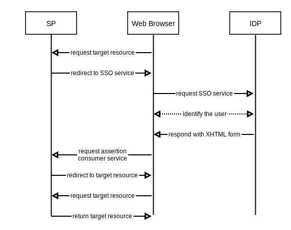

# SAML Integration

SAML2 is version 2 of SAML (Security Assertion Markup Language), an XML-based standard for exchanging authentication and authorization data. The document of SAML2 Specifications is available [here](http://saml.xml.org/saml-specifications).

According to SAML2 Specifications, two parties which exchange
authentication and authorization data are called SP (Service Provider)
and IDP (Identity Provider). IDP issues the security assertion and SP
consumes it. The following scenario describes a SAML2 exchange:

1. A user, via web browser, requests a resource at the SP.
2. The SP checks and finds no security context for the request, then it
   redirects to the SSO service.
3. The browser requests the SSO service at IDP.
4. The IDP responds with an XHTML form after performing security check and
   identifying the user. The form contains SAMLResponse value.
5. The browser requests assertion consumer service at the SP.
6. The consumer service processes the SAMLResponse, creates a security
   context and redirects to the target resource.
7. The browser requests target resource again.
8. The SP finds a security context, so it returns the target resource.



eXo Platform SAML integration supports the SP role thus can be
integrated with various [IdP providers](https://en.wikipedia.org/wiki/SAML-based_products_and_services)
such as Salesforce or Shibboleth.

This chapter covers the following subjects:

-  [eXo Platform as SAML2 SP](#exo-platform-as-saml2-sp)

-  [Generating and using your own keystore](#generating-and-using-your-own-keystore)

## eXo Platform as SAML2 SP

### 1. Install SAML2 add-on with the command:

```bash
$PLATFORM_SP/addon install exo-saml
```

### 2. Open the file `$PLATFORM_SP/gatein/conf/exo.properties`.

Edit the following properties (add them if they don't exist):

```properties
# SSO
gatein.sso.enabled=true
gatein.sso.saml.sp.enabled=true
gatein.sso.callback.enabled=true
gatein.sso.valve.enabled=true
gatein.sso.valve.class=org.gatein.sso.saml.plugin.valve.ServiceProviderAuthenticator
gatein.sso.filter.login.sso.url=/portal/dologin

gatein.sso.filter.initiatelogin.enabled=false
gatein.sso.filter.logout.enabled=true
gatein.sso.filter.logout.class=org.gatein.sso.saml.plugin.filter.SAML2LogoutFilter
gatein.sso.filter.logout.url=${gatein.sso.sp.url}?GLO=true 
gatein.sso.saml.config.file=${exo.conf.dir}/saml2/picketlink-sp.xml

# Custom properties

gatein.sso.sp.host=SP_HOSTNAME
gatein.sso.sp.url=${gatein.sso.sp.host}/portal/dologin
gatein.sso.idp.host=IDP_HOSTNAME
gatein.sso.idp.url=IDP_SAML_ENDPOINT
gatein.sso.idp.url.logout=IDP_SAML_ENDPOINT_LOGOUT
gatein.sso.idp.alias=IDP_SIGNING_ALIAS
gatein.sso.sp.alias=SP_SIGNING_ALIAS
gatein.sso.sp.signingkeypass=SP_SIGNING_KEY_PASS
gatein.sso.picketlink.keystorepass=SP_KEYSTORE_PASS
# WARNING: This bundled keystore is only for testing purposes. You should generate and use your own keystore!
gatein.sso.picketlink.keystore=${exo.conf.dir}/saml2/jbid_test_keystore.jks
```

You need to modify **gatein.sso.idp.host**, **gatein.sso.idp.url**, **gatein.sso.idp.url.logout**, **gatein.sso.idp.alias**, **gatein.sso.sp.alias**, **gatein.sso.sp.signingkeypass** and **gatein.sso.picketlink.keystorepass** according to your environment setup. You also need to install your own keystore as instructed in [Generating and using your own keystore](#generating-and-using-your-own-keystore).

::: tip
If your IDP send username in assertion with some char in capital letter, and you want to force lower case, you can add this property :

```properties
gatein.sso.saml.username.forcelowercase=true
```
::: 

### 3. Download and import your generated IDP certificate to your keystore

The certificate provided here is the public key provided by the IDP. This certificate will allow to verify signature of assertions coming from the IDP. 

In addition, if the IDP is configured to encrypt assertions, this certificate will be used to decrypt it.

```bash
keytool -import -keystore jbid_test_keystore.jks -file idp-certificate.crt -alias Identity_Provider-idp -storetype JKS
```
::: tip
The Default password of the keystore jbid\_test\_keystore.jks is **store123**.
:::

::: warning
For production environment, ensure to create a new keystore, with a more robust password. Ensure to save the keystore password
:::

### 4.  Create a couple private key/public key and add it to the keystore

To be able to sign assertions, you will need to create a private key and a public key, and add it to the keystore.

#### 4.1. Create private key and certificate :
```bash
openssl req -newkey rsa:4096 -keyout private.key -x509 -days 365 -out certificate.crt
```

#### 4.2. Transform certificate and private key in p12 file :
```bash
openssl pkcs12 -export -out certificate.p12 -inkey private.key -in certificate.crt
```

#### 4.3. Add p12 file in jks store

```bash
keytool -v -importkeystore -srckeystore certificate.p12 -srcstoretype PKCS12 -destkeystore jbid_test_keystore.jks -deststoretype JKS -destalias sp_alias -srcalias 1
```

You will be asked to enter the *keystore password* and a *key password* for the private key.
Remember them to use in next steps.
This command create a couple (publicKey, privateKey). 
This couple is added is the keystore with alias *sp_alias* (you can change it)

During IDP configuration, you can provide the publicKey to the IDP, which will use is to validate assertion signature if the feature is activated on IDP side.

::: tip 
In the command, srcalias indicate which alias from the P12 keystore we want to import in the JKS keystore. The P12 keystore can contains more than one key. As we just create it, we know that the alias we want is the first one.
:::

#### 4.4. Update properties
Change these properties :

```properties
gatein.sso.sp.signingkeypass=*key password*
gatein.sso.picketlink.keystorepass=*keystore password*
gatein.sso.sp.alias=sp_alias
```

#### 4.5. Provide SP public key to IDP
On IDP side, to be able to validate assertion signature, you will need to provide the SP public key, create in point 4.1

The process to store the public key will vary in function of your IDP.


### 5. Start up the platform: use the following command on Linux operating systems:
```bash
./start_eXo.sh
```

and use this command for Windows operating systems:
```bash
start_eXo.bat
```

## Keep the portal login page next to the SAML login

By default, once the SAML2 add-on is configured, eXo Platform has no login page of its own: every visitor who needs to sign in is redirected to the IDP, and local passwords cannot be used. From eXo Platform 7.3, the add-on can keep the portal login page and add a **Sign in with SAML** button next to the login form (and next to the other providers, such as OpenID). Nothing changes unless you enable it.

Add these properties to `$PLATFORM_SP/gatein/conf/exo.properties`, in addition to the SAML properties above:

```properties
gatein.sso.skip.jsp.redirection=false
gatein.sso.saml.login.page.enabled=true
gatein.sso.filter.logout.class=org.exoplatform.addons.saml.extensions.HybridSAML2LogoutFilter
gatein.sso.valve.class=org.exoplatform.addons.saml.extensions.SamlServiceProviderAuthenticator
# Optional: clients that must use the SAML login
gatein.sso.saml.login.enforced.ips=10.0.0.0/8, 192.168.1.10, 172.16.5.1-172.16.5.50
```

| Property | Description |
|----|----|
| `gatein.sso.skip.jsp.redirection` | Must be exactly `false`, so that the portal login page is displayed instead of redirecting to the IDP. |
| `gatein.sso.saml.login.page.enabled` | Displays the SAML button on the login page and enables the list of enforced addresses. `false` by default. |
| `gatein.sso.filter.logout.class` | Replaces the SAML logout filter of the setup above. The users who signed in with SAML are logged out at the IDP too; the users who signed in with a local password get the regular portal logout (with the stock filter, their logout ends on a blank page and the session stays half closed). `gatein.sso.filter.logout.enabled` must stay `true`. |
| `gatein.sso.valve.class` | Replaces the SAML valve of the setup above. Used together with the logout filter, it keeps the logout of a SAML user whose portal session expired working, see [Logout of a user whose portal session expired](#logout-of-a-user-whose-portal-session-expired). |
| `gatein.sso.saml.login.enforced.ips` | Optional. IP addresses, CIDR blocks (`10.0.0.0/8`, `2001:db8::/32`) and ranges (`10.1.1.10-10.1.1.20`), separated by comma, semicolon or space. Host names are not accepted. |

::: warning
Do not enable the SAML login module of the SSO integration (`gatein.sso.login.module.enabled=true` with `org.gatein.sso.agent.login.SAML2IntegrationLoginModule`) with the login page: this login module refuses the logins that do not come from SAML, so local passwords and OpenID would no longer work. The SAML valve and callback sign the SAML users in without it.
:::

### Send some clients straight to the IDP

With `gatein.sso.saml.login.enforced.ips`, an anonymous client whose address is listed is redirected to the IDP when it opens the login page or submits a password: it cannot sign in with a local password, and the other clients keep the login page. An address that cannot be parsed is treated as listed. An invalid entry of the list is ignored and logged at error level (the startup log shows `SAML login enforced for the client addresses`), so check that line after a change.

::: warning
This is not an access control. It does not cover the HTTP Basic and Digest authentication of the REST (`/rest/private`) and WebDAV applications, nor the remember-me cookie sent to the REST endpoints of the other web applications. Block these at the reverse proxy for the networks that must use SAML.
:::

The address used is the one Tomcat reports for the request. Behind a reverse proxy it is the client address read from `X-Forwarded-For` by the `RemoteIpValve` of the server, when the proxy is one of its trusted proxies (`internalProxies`, every private range by default). With these default settings, a client of a private network can choose the address it is seen with by sending that header: restrict `internalProxies` to your own reverse proxies, otherwise the list can be bypassed. A list that has only IPv4 entries does not match a client that reaches the server over IPv6, and conversely.

### Logout of a user whose portal session expired

The logout filter knows that a user signed in with SAML from a marker stored in the portal session. If this session expires while the user keeps a session in another web application (REST or WebDAV, which also give a session through the `SingleSignOn` valve of Tomcat), Tomcat signs the user back in to a new portal session that has no marker. The logout is then the regular portal logout, the session at the IDP stays open, and the next **Sign in with SAML** needs no password. This is not specific to the login page: any SAML setup whose users keep such a session meets it, and the stock SAML logout filter does not avoid it.

The `gatein.sso.valve.class` and `gatein.sso.filter.logout.class` of the properties above are the pair that closes it: neither works alone. The valve gives the SAML user a principal that the `SingleSignOn` valve keeps, and the logout filter recognizes it. It needs the `SingleSignOn` valve of Tomcat at its default (not `requireReauthentication="true"`). Without the pair, close the browser after logging out on shared computers.

### OpenID next to SAML

The login page can show the OpenID button next to the SAML one. Configure OpenID as described in [OAuth integration](/docs/administration/oauth-integration.md) (`exo.oauth.openid.*`) in addition to the properties above. When the logout is propagated to an OpenID IDP (`exo.oauth.openid.propagate.logout=true`), an OpenID user is logged out at that IDP, and a SAML user at the SAML IDP.

## Use Another signature algotihm
To sign assertion, we use RSA256 by default.
If you want to change this, you can update theses properties :

```properties
gatein.sso.sp.sign.method=http://www.w3.org/2001/04/xmldsig-more#rsa-sha256
gatein.sso.sp.sign.digest=http://www.w3.org/2001/04/xmlenc#sha256
```

List of Signature Methods can be found in javax.xml.crypto.dsig.SignatureMethod.

List of Digest Methods can be found in javax.xml.crypto.dsig.DigestMethod.

## Use Encrypted Assertions

To increase security, IDP can be configured to encrypt assertions, it is an option to activate. The IDP will use his private key to encrypt, and the SP will use the IDP public key to decrypt.

As we already have the IDP public key in the keystore, the assertion decryption should work directly

## Configure NameId Format in SAMLRequest

The property `gatein.sso.saml.nameid.format` allow to configure the wanted nameid format. By dafault, value is `urn:oasis:names:tc:SAML:2.0:nameid-format:persistent`. It can be changed to `urn:oasis:names:tc:SAML:1.1:nameid-format:unspecified` if needed

## Use assertion with persistent or transient nameid
Some IDP requires that nameid contains a unique identifier, which will not change during this. 
In this case, we need that IDP provide the user name or the email in another assertion attribute.

- On IDP side, configure the Client scope to provide username or email in an attribute of the assertion. Note the name of the attribute, for example `uid`.
- on eXo side, set the property `gatein.sso.saml.use.namedid=false` and `gatein.sso.saml.subject.attribute` to the name of the attribute you want to use. For example, if you set `gatein.sso.saml.subject.attribute=uid`, eXo will use the value of the `uid` attribute in the assertion as username.

::: tip 

The user can be identified by his username or by his email.
:::
